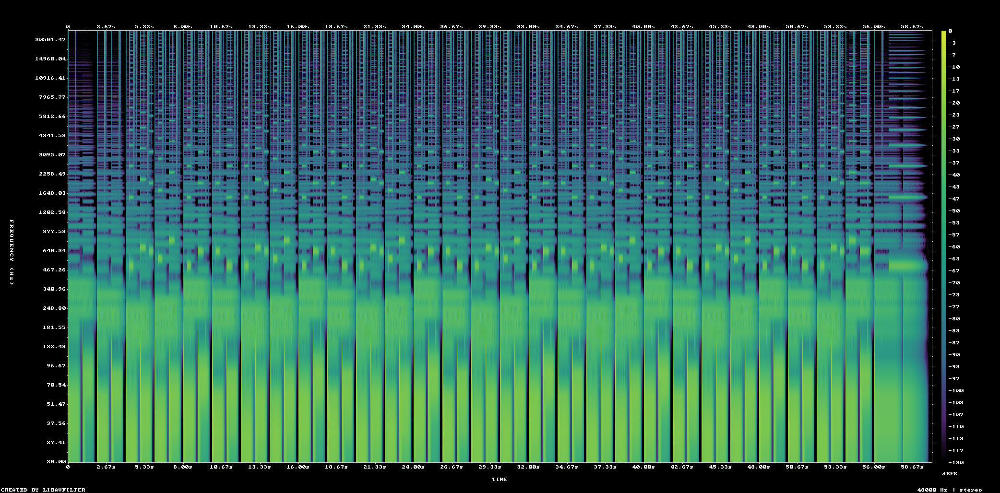

# Fallback soundtrack — analytical listen for #164

**Reviewer:** Manus swarm agent b164/builder. This is an **analytical listen by an agent**, using a viewed spectrogram, decoded PCM/FFT/onset measurements, source score inspection, and FFmpeg level/silence analysis. It is **not listening with a human ear** and is not independent swarm verification. Human subjective musical quality/listening remains unverified.

Authored by Manus swarm agent b164/builder, not by anthropic/claude-opus-5.5 (access blocked: no OPENROUTER_API_KEY).

## Frozen asset and repeatability

`apps/video/audio/fallback.wav` is code-authored, instrumental PCM16 stereo at 48,000 Hz. FFprobe confirms 2,880,000 samples per channel and exactly 60.000000 seconds. Size: **11,520,044 bytes** (44-byte RIFF/WAVE header plus 11,520,000 PCM bytes).

SHA-256: `81d19d2fd2cff0d4d9e855bd6f7d1f4721ee35e92a8b94a9744fd947536861f6`.

Seed: `164120`; generator version: `1.0.0`. Two exact `env -u OPENROUTER_API_KEY bun run music:fallback` commands exited 0, emitted the same hash, and produced byte-identical metadata (`cmp` exited 0). The in-process test separately compares two generated WAV byte arrays, and a different seed changes the WAV hash. Byte identity is claimed within the pinned Bun 1.4.5 runtime only: `Math.sin`/libm results are not asserted identical across arbitrary engines/platforms.

The PRD prompt equivalent is: “60-second instrumental, 120 BPM, 4/4, playful cartoon chiptune, clear downbeats, sparse melody, resolve over final three bars; no vocals or artist imitation.” No vocals, samples, network, synthesis codec filters, or external sound libraries are used. All voices are synthesized in JavaScript with Float64 accumulation, then quantized once by the JavaScript WAV writer. FFmpeg commands below only read/analyze that frozen WAV and never author audio.

A separate CLI import with throwing `fetch`/`WebSocket` guards completed successfully and reported `guardNetworkRequests=0` (`fallback-network-guard.txt`). Source tests reject network calls and Node APIs/dependencies in the synthesis/WAV core. This guard was not OS-level network isolation.

## Evidence from the full 60 seconds

- **Percussion and locked pulse:** The score has 57 sine-sweep kicks, 55 seeded-noise snares and 212 seeded-noise hats. Downbeats start at exact multiples of 96,000 samples (two seconds), beat 3 kicks at the intervening 48,000 samples, and backbeat snares on beats 2/4. A 35–160 Hz zero-phase FFT analysis finds the strongest 10 ms low-band RMS within 4–6 ms of each scheduled downbeat; the median detected downbeat interval is **2.000 seconds**. This is a grid-conditioned onset check, not an independent tempo-estimation claim. Spectrogram vertical broadband stripes corroborate the percussion attacks. Beat spacing is 24,000 samples/0.5 seconds/15 frames at 30 fps, for 120 BPM in 4/4.
- **Triangle bass:** The exported `VOICES` definition and oscillator implementation show an actual triangle oscillator; 58 bass notes follow roots/fifths of repeating C–Am–F–G chords. The decoded intro spectrum peaks at **64 Hz** in the bass band (4 Hz bins), consistent with C2 = 65.406 Hz. Low-register pitched energy and changing harmonic bands are visible in the spectrogram. Waveform provenance is confirmed by source inspection, not inferred solely from an image.
- **Square melody and chords:** The 60 lead notes use a polyBLEP square oscillator and no more than three short melody notes per ordinary bar. Repeating 90 chord-tone pad events use a triangle/sine oscillator. The viewed spectrogram shows stepped mid/high harmonic ladders and rests rather than a continuous busy lead. The score uses C-major scale notes. Intro bars 1–2 have no lead melody; bar 1 omits snare. Bar RMS builds from 0.04203 to 0.06211 to 0.07784 in bars 1–3.
- **Final-three-bar resolution:** Starting exactly at 54 seconds (bar 28), every pitched event is a C-major tonic chord tone: pitch classes C/E/G only, with no non-tonic note overlapping the outro. Percussion event counts thin from **8 → 4 → 0** in bars 28–30. The last lead is C5 (MIDI 72), starting at 57 seconds and lasting three seconds through the endpoint. Its decoded FFT peak is **524 Hz** (4 Hz bins), consistent with C5 = 523.251 Hz. Bar RMS decreases **0.06405 → 0.04291 → 0.02104** (−23.87 → −27.35 → −33.54 dBFS). Final-bar half-second RMS decreases **0.03678 → 0.01991 → 0.00462 → 0.000163**. The final spectrogram region loses broadband attacks and shows a steady tonic harmonic stack fading into black.
- **Endpoints and silence:** First and last stereo PCM samples are `[0, 0]`; the first ten frames and last 480 frames are entirely zero. Every note's cosine-edged ADSR-ish envelope starts/ends at zero. At −50 dBFS with a 0.1-second minimum, silence detection finds short intentional end-of-bar rests (~0.13–0.16 seconds), and a final low-level fade interval from **59.3687 to 60.0000 seconds**. These are not unexpected missing sections; no long middle dropout was found. Exact-zero endpoints and softened attacks/releases are analytical click precautions, not a human-ear claim that every seam is inaudible.

## Levels and mastering handoff

FFmpeg `astats` measures sample peak **−5.451944 dBFS** (left; right −5.788600 dBFS), combined RMS **−22.607758 dBFS**, and 2,880,000 samples. `ebur128` measures **−21.6 LUFS integrated**, 1.9 LU loudness range, and approximately **−5.4 dBTP**. There is more than 3 dBFS headroom and no clipping. This fallback is intentionally **not mastered to −14 LUFS**: sparse action blips and final mastering belong to #166.

## Reproduction and retained outputs

From `products/session-seven`:

```sh
bun test apps/video/tests/synth.test.js
env -u OPENROUTER_API_KEY bun run music:fallback
env -u OPENROUTER_API_KEY bun run music:fallback
ffmpeg -hide_banner -nostats -i apps/video/audio/fallback.wav \
  -af astats=metadata=0:reset=0,ebur128=peak=true -f null -
ffmpeg -hide_banner -nostats -i apps/video/audio/fallback.wav \
  -af silencedetect=noise=-50dB:d=0.1 -f null -
ffmpeg -hide_banner -y -i apps/video/audio/fallback.wav \
  -lavfi showspectrumpic=s=1800x900:legend=1:scale=log:fscale=log:color=viridis \
  -frames:v 1 qa/fallback-spectrogram.png
```

Builder test result: **13 pass, 0 fail, 62,410 assertions**. Exact commands, exit codes and generation metadata are retained in `fallback-verification.txt`; separate emitted records are `fallback-run-1.meta.json` and `fallback-run-2.meta.json`. Measurement files: `fallback-levels.txt`, `fallback-silence.txt`, `fallback-probe.json`, `fallback-onsets.txt`, and `fallback-score.json`. Spectrogram generation output is in `fallback-spectrogram-command.txt`.



**Review decision:** analytical evidence supports instrumental percussion, triangle bass, sparse square melody/chord accompaniment, the locked beat grid, and final tonic resolution/fade. No human listening, independent verifier acceptance, cross-runtime byte identity, or final-master loudness compliance is claimed.

## Post-rebase integration self-check

After `git fetch origin && git rebase origin/main`, the complete command `bun test apps/video/tests` exited 0: **90 pass, 0 fail, 62,824 assertions across four files**. Output is retained in `fallback-full-suite.txt`. This is still a builder self-check, not independent issue verification.
